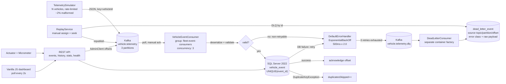

# FleetEventStream

## 1. What it does

FleetEventStream is an event-driven connected-vehicle telemetry pipeline. A configurable simulator publishes V2X-style telemetry (position, speed, heading, alert codes, and a small percentage of deliberately malformed payloads) to Apache Kafka, keyed by vehicle so each vehicle's stream stays ordered. A Spring Boot consumer group reads `vehicle.telemetry` with manual acknowledgements, validates each record, and writes it idempotently into SQL Server using a unique `event_id` index; validation failures go straight to the dead-letter path and transient database failures are retried with exponential backoff before being dead-lettered. A separate consumer persists dead letters with their original topic/partition/offset and root-cause error, while offset replay and DLQ replay make recovery auditable. A Spring Boot REST API exposes event lookup, per-vehicle history, throughput, latency, consumer lag, DLQ statistics, and a composite pipeline health check, and a dependency-free vanilla JavaScript dashboard polls those endpoints every two seconds to show live throughput, partition lag, DLQ counts, and simulator controls.

## 2. Architecture



The pipeline is deliberately asymmetric: the live path is optimized for validation and idempotent persistence, while failures never disappear silently. Poison pills are classified as non-retryable and land in the DLQ immediately; transient persistence failures use Kafka's in-place retry with exponential backoff and are published to the DLQ only after retries are exhausted.

### Modules and responsibilities

| Package / module | Responsibility |
|---|---|
| `com.fleeteventstream.simulator` | Rate-accurate fleet simulator (10 ms scheduler ticks, elapsed-time target), route drift, speed jitter, alert codes, malformed injection, start/stop/status REST endpoints. |
| `com.fleeteventstream.kafka` | JSON `TelemetryProducer` keyed by `vehicleId`, published/failed send counters, raw-payload publishing for poison-pill tests. |
| `com.fleeteventstream.model` | `VehicleEvent` record with Jakarta Bean Validation constraints and a stable JSON contract (`eventTime` is ISO-8601). |
| `com.fleeteventstream.config` | `NewTopic` beans (3 partitions for telemetry, 1 each for retry/DLQ), consumer/error-handler factories, shared `AdminClient`. |
| `com.fleeteventstream.consumer` | Manual-ack `VehicleEventConsumer`, `DeadLetterConsumer`, root-cause `EventValidationException`. |
| `com.fleeteventstream.persistence` | `JdbcTemplate` repositories: idempotent `insertIfAbsent`, history/vehicle/throughput/latency queries, DLQ inserts and paging. |
| `com.fleeteventstream.replay` | Manually assigned consumer with a throwaway group id; offset replay and DLQ-by-id replay; never commits into the live group. |
| `com.fleeteventstream.api` | REST controllers, validation, consistent `ApiError` responses, `AdminController`, `StatsController`. |
| `com.fleeteventstream.observability` | Ingestion counters, broker-derived consumer lag (`AdminClient`), composite pipeline health. |
| `src/main/resources/static` | `index.html`, `app.js`, `styles.css`: no build step, no CDN, no framework. |
| `src/main/resources/db/migration` | Flyway `V1__create_schema.sql`; the schema is the idempotency contract. |
| `src/test/java` | Unit/slice tests and `PipelineIT` Testcontainers integration suite. |
| `scripts` | `dev-up.sh`, `dev-down.sh`, `benchmark.sh`, `lint.sh`; `Makefile` wraps the common targets. |
| `SECURITY.md` | Credential handling, SQL parameterization, input limits, actuator exposure, and production gaps. |

### Database schema

`vehicle_event` stores one row per telemetry event. `event_id` is unique; that index, not an application-side read-before-write check, is what makes replays safe.

| Column | Type | Notes |
|---|---|---|
| `id` | `BIGINT IDENTITY` | Primary key. |
| `event_id` | `NVARCHAR(64)` | Unique index `ux_vehicle_event_event_id`; idempotency key. |
| `vehicle_id` | `NVARCHAR(32)` | Vehicle key; indexed with event time. |
| `event_time` | `DATETIME2(7)` | UTC event timestamp from the producer. |
| `latitude`, `longitude` | `FLOAT` | Bounds enforced by Bean Validation. |
| `speed_kph`, `heading_deg` | `FLOAT` | Bounds enforced by Bean Validation. |
| `alert_code` | `NVARCHAR(32) NULL` | Optional upper-case alert code. |
| `payload` | `NVARCHAR(MAX)` | Original Kafka value, retained for audit. |
| `ingested_at` | `DATETIME2(7)` | Defaults to `SYSUTCDATETIME()`; indexed for throughput. |

Indexes: `ux_vehicle_event_event_id` (unique), `ix_vehicle_event_vehicle_time (vehicle_id, event_time DESC)`, `ix_vehicle_event_ingested_at`.

`dead_letter_event` stores the failed record metadata: `id`, `source_topic`, `partition_id`, `source_offset`, `failure_reason`, `error_class`, `raw_payload NVARCHAR(MAX)`, `failed_at`, `retry_count`. Indexes on `failed_at DESC` and `failure_reason`; Flyway V2 adds a unique index on `(source_topic, partition_id, source_offset)` so a DLQ redelivery after a crash cannot create a duplicate audit row.

## 3. How to run

### Prerequisites

- JDK 17 or newer (the build targets Java 17; this build ran on JDK 21).
- Docker Engine / Docker Desktop with Compose v2 and at least ~6 GB of RAM available to containers.
- Bash, `curl`, and `jq` for the helper scripts.
- No local Kafka or SQL Server installation is required.

### Configure credentials

`docker-compose.yml` reads the SQL Server SA password from the environment. The real `.env` is git-ignored; only `.env.example` is committed.

```bash
cp .env.example .env
# Edit .env and set a strong MSSQL_SA_PASSWORD (and matching DB_PASSWORD usage below).
```

See [`SECURITY.md`](SECURITY.md) for credential handling, SQL parameterization, input limits, and
the production gaps (TLS/SASL, least-privilege DB login, authenticated admin endpoints).

### Option A — full stack in Docker Compose

```bash
./scripts/dev-up.sh
```

This builds the multi-stage image (Maven build → JRE runtime), starts Kafka (KRaft, single node), SQL Server 2022, a one-shot init service that creates the `fleeteventstream` database, and the app. Wait for the health check, then open:

**Dashboard: <http://localhost:8080>**

Stop it with `./scripts/dev-down.sh`. Use `docker compose down -v` to also delete the Kafka/SQL Server volumes.

### Option B — infrastructure in Docker, app with Maven

```bash
docker compose up -d kafka sqlserver sqlserver-init
set -a; source .env; set +a
export DB_PASSWORD="$MSSQL_SA_PASSWORD"
./mvnw spring-boot:run
```

The default profile expects Kafka at `localhost:9092` and SQL Server at `localhost:1433`. The Docker profile (`SPRING_PROFILES_ACTIVE=docker`) uses the in-network hostnames `kafka:29092` and `sqlserver:1433`.

### Simulator

```bash
# Start 200 events/sec, 20 vehicles, for 60 seconds (0 = until stopped)
curl -s -X POST http://localhost:8080/api/simulator/start \
  -H 'Content-Type: application/json' \
  -d '{"eventsPerSecond":200,"vehicleCount":20,"durationSeconds":60}' | jq .

curl -s http://localhost:8080/api/simulator/status | jq .
curl -s -X POST http://localhost:8080/api/simulator/stop | jq .
```

The default malformed rate is 2% (`fleet.simulator.malformed-rate`). The dashboard has Start / Stop / Replay buttons.

### REST API

All endpoints return JSON. Validation failures use HTTP 400, unknown events use 404, and the error body is consistent (`timestamp`, `status`, `error`, `message`, `path`, `details`).

| Method | Path | Purpose |
|---|---|---|
| GET | `/api/events/{eventId}` | Single event or 404. |
| GET | `/api/vehicles/{vehicleId}/history?from=&to=&limit=` | Newest-first history, optional ISO-8601 range, limit capped at 1000. |
| GET | `/api/vehicles?limit=` | Vehicles with event count and last-seen timestamp. |
| GET | `/api/stats/throughput?windowSeconds=` | Per-second ingestion buckets, total, average, peak. |
| GET | `/api/stats/latency?windowSeconds=&since=` | p50/p95/p99 end-to-end latency (`ingested_at - event_time`). |
| GET | `/api/stats/lag` | Per-partition committed/end offsets, total lag, group state, members. |
| GET | `/api/stats/dlq` | Total DLQ rows, last-hour count, top failure reasons. |
| GET | `/api/stats/pipeline` | In-process counters plus database row counts. |
| GET | `/api/health/pipeline` | Composite 200/503: Kafka reachable, DB reachable, lag under threshold. |
| GET | `/api/admin/dlq?page=&size=` | Recent dead letters with source coordinates. |
| POST | `/api/admin/replay` | Replay `{topic, partition, fromOffset, maxRecords}` onto the main topic. |
| POST | `/api/admin/replay/dlq` | Replay stored dead letters by id: `{ids:[...]}`. |
| GET | `/actuator/health` | Spring Boot liveness/readiness/DB health. |
| GET | `/actuator/metrics` | Micrometer counters and the processing timer. |
| GET | `/actuator/prometheus` | Prometheus scrape endpoint, including the processing p50/p95/p99 quantiles. |

#### Real sample responses

The following responses were captured from the running compose stack while the simulator was producing telemetry. The complete capture is in [`docs/run-logs/step4-api-samples.json`](docs/run-logs/step4-api-samples.json).

**Event lookup** — `GET /api/events/d394fdfc-22d9-44f1-b7c0-fe963bf508e9`

```bash
curl -s http://localhost:8080/api/events/d394fdfc-22d9-44f1-b7c0-fe963bf508e9 | jq .
```

```json
{
  "id": 55216,
  "eventId": "d394fdfc-22d9-44f1-b7c0-fe963bf508e9",
  "vehicleId": "veh-0019",
  "eventTime": "2026-10-18T08:07:40.330545Z",
  "latitude": 37.779592,
  "longitude": -122.430085,
  "speedKph": 9.29,
  "headingDeg": 271.51,
  "alertCode": null,
  "payload": "{\"eventId\":\"d394fdfc-22d9-44f1-b7c0-fe963bf508e9\",\"vehicleId\":\"veh-0019\",\"eventTime\":\"2026-10-18T08:07:40.330545Z\",\"latitude\":37.779592,\"longitude\":-122.430085,\"speedKph\":9.29,\"headingDeg\":271.51,\"alertCode\":null}",
  "ingestedAt": "2026-10-18T08:07:40.414457500Z"
}
```

**Vehicle history** — `GET /api/vehicles/veh-0019/history?limit=5` (abridged: 5 events returned, first shown)

```bash
curl -s 'http://localhost:8080/api/vehicles/veh-0019/history?limit=5' | jq .
```

```json
{
  "vehicleId": "veh-0019",
  "from": null,
  "to": null,
  "limit": 5,
  "count": 5,
  "events": [
    {
      "id": 55216,
      "eventId": "d394fdfc-22d9-44f1-b7c0-fe963bf508e9",
      "vehicleId": "veh-0019",
      "eventTime": "2026-10-18T08:07:40.330545Z",
      "latitude": 37.779592,
      "longitude": -122.430085,
      "speedKph": 9.29,
      "headingDeg": 271.51,
      "alertCode": null,
      "payload": "{\"eventId\":\"d394fdfc-22d9-44f1-b7c0-fe963bf508e9\",\"vehicleId\":\"veh-0019\",\"eventTime\":\"2026-10-18T08:07:40.330545Z\",\"latitude\":37.779592,\"longitude\":-122.430085,\"speedKph\":9.29,\"headingDeg\":271.51,\"alertCode\":null}",
      "ingestedAt": "2026-10-18T08:07:40.414457500Z"
    }
  ]
}
```

**Vehicles** — `GET /api/vehicles?limit=5`

```json
{
  "count": 5,
  "vehicles": [
    {"vehicleId": "veh-0020", "eventCount": 2760, "lastSeen": "2026-10-18T08:07:40.330635Z"},
    {"vehicleId": "veh-0019", "eventCount": 2747, "lastSeen": "2026-10-18T08:07:40.330545Z"},
    {"vehicleId": "veh-0018", "eventCount": 2753, "lastSeen": "2026-10-18T08:07:40.320579Z"},
    {"vehicleId": "veh-0017", "eventCount": 2747, "lastSeen": "2026-10-18T08:07:40.310432Z"},
    {"vehicleId": "veh-0016", "eventCount": 2747, "lastSeen": "2026-10-18T08:07:40.310348Z"}
  ]
}
```

**Throughput** — `GET /api/stats/throughput?windowSeconds=60` (abridged: 50 one-second points)

```json
{
  "windowSeconds": 60,
  "from": "2026-10-18T08:06:51.278454Z",
  "to": "2026-10-18T08:07:51.278454Z",
  "totalEvents": 7577,
  "eventsPerSecond": 126.28333333333333,
  "peakEventsPerSecond": 383,
  "points": [
    {"bucket": "2026-10-18T08:06:51Z", "eventCount": 204}
  ]
}
```

**Consumer lag** — `GET /api/stats/lag`

```json
{
  "groupId": "fleet-event-consumers",
  "topic": "vehicle.telemetry",
  "totalLag": 0,
  "groupState": "Stable",
  "members": 3,
  "partitions": [
    {"partition": 0, "committedOffset": 19853, "endOffset": 19853, "lag": 0},
    {"partition": 1, "committedOffset": 16844, "endOffset": 16844, "lag": 0},
    {"partition": 2, "committedOffset": 19649, "endOffset": 19649, "lag": 0}
  ]
}
```

**DLQ stats** — `GET /api/stats/dlq`

```json
{
  "total": 1136,
  "lastHour": 1136,
  "lastHourSince": "2026-10-18T07:07:51.380068Z",
  "topFailureReasons": [
    {
      "failureReason": "Unexpected end-of-input within/between Object entries\n at [Source: REDACTED (`StreamReadFeature.INCLUDE_SOURCE_IN_LOCATION` disabled); line: 1, column: 127]",
      "count": 1136
    }
  ]
}
```

**Pipeline counters** — `GET /api/stats/pipeline`

```json
{
  "consumed": 9000,
  "persisted": 8807,
  "duplicatesSkipped": 0,
  "failed": 193,
  "dlqStored": 193,
  "vehicleRows": 55020,
  "deadLetterRows": 1136
}
```

**Composite health** — `GET /api/health/pipeline` (HTTP 200; returns 503 with the same body shape when degraded)

```json
{
  "healthy": true,
  "status": "UP",
  "kafkaReachable": true,
  "databaseReachable": true,
  "totalLag": 0,
  "lagThreshold": 5000,
  "lagUnderThreshold": true,
  "consumerGroupState": "Stable",
  "checkedAt": "2026-10-18T08:07:51.506493Z",
  "details": {}
}
```

**Recent dead letters** — `GET /api/admin/dlq?page=0&size=5` (first row shown)

```json
{
  "items": [
    {
      "id": 1136,
      "sourceTopic": "vehicle.telemetry",
      "partitionId": 0,
      "sourceOffset": 1135,
      "failureReason": "Unexpected end-of-input within/between Object entries\n at [Source: REDACTED (`StreamReadFeature.INCLUDE_SOURCE_IN_LOCATION` disabled); line: 1, column: 127]",
      "errorClass": "com.fasterxml.jackson.core.io.JsonEOFException",
      "rawPayload": "{\"eventId\":\"3ad652bf-0909-47ac-b729-06d44c394aa2\",\"vehicleId\":\"veh-0019\",\"eventTime\":\"2026-10-18T08:07:40.194077Z\",\"latitude\":",
      "failedAt": "2026-10-18T08:07:40.316004700Z",
      "retryCount": 0
    }
  ],
  "page": 0,
  "size": 5,
  "total": 1136
}
```

**Error example** — unknown event returns 404:

```json
{
  "timestamp": "2026-10-18T08:07:51.620130Z",
  "status": 404,
  "error": "Not Found",
  "message": "No event found with eventId=does-not-exist",
  "path": "/api/events/does-not-exist",
  "details": null
}
```

Invalid parameters return 400 (for example `limit=1001` → `"vehicles.limit must be less than or equal to 1000"`), and an unsupported method returns 405.

### Replay commands

Replay a consumed offset range (the example republishes 200 records from partition 0; keying and idempotency make this safe):

```bash
curl -s -X POST http://localhost:8080/api/admin/replay \
  -H 'Content-Type: application/json' \
  -d '{"topic":"vehicle.telemetry","partition":0,"fromOffset":0,"maxRecords":200}' | jq .
```

```json
{
  "topic": "vehicle.telemetry",
  "partition": 0,
  "fromOffset": 0,
  "recordsRead": 200,
  "recordsRepublished": 200,
  "skipped": 0,
  "endOffset": 4200
}
```

Replay stored DLQ rows by id:

```bash
curl -s -X POST http://localhost:8080/api/admin/replay/dlq \
  -H 'Content-Type: application/json' \
  -d '{"ids":[244,243]}' | jq .
```

```json
{"requested":2,"found":2,"republished":2,"skipped":0,"missing":0}
```

DLQ replay is intentionally not magic: replaying an unfixed malformed payload will produce a new dead letter. Fix the parser/schema or the upstream producer first.

### Make targets

| Target | Action |
|---|---|
| `make up` | Build and start the full Compose stack. |
| `make down` | Stop the stack (volumes are kept). |
| `make run` | Run the app with Maven against local infra; loads `.env`. |
| `make test` | Unit/MVC tests (no Docker). |
| `make verify` | Unit + real Testcontainers integration tests. |
| `make bench` | 2,000/s benchmark; writes `docs/run-logs/benchmark.txt`. |
| `make lint` | Compile, JS syntax, live-secret scan, SQL-concatenation scan, Compose config. |

### Observability

`IngestionStats` maintains the raw counters used by the JSON API and mirrors them to Micrometer:

| Meter | Type | Meaning |
|---|---|---|
| `fleet.events.consumed` | Counter | Records delivered to the listener. |
| `fleet.events.persisted` | Counter | New rows inserted. |
| `fleet.events.duplicates` | Counter | Duplicate `event_id` rows skipped. |
| `fleet.events.failed` | Counter | Failed processing attempts. |
| `fleet.events.processing` | Timer | Parse + validate + persist duration, with p50/p95/p99 quantiles. |
| `fleet.dlq.stored` | Counter | Dead-letter rows written to SQL Server. |
| `fleet.dlq.published` | Counter | Records published to the Kafka DLQ topic. |
| `fleet.dlq.duplicates` | Counter | DLQ redeliveries suppressed by the unique source index. |

Inspect them with `curl -s http://localhost:8080/actuator/metrics/fleet.events.consumed | jq .` and
`curl -s http://localhost:8080/actuator/prometheus | grep '^fleet_'`. The dashboard surfaces the
consumed count and processing p95 (the p95 is read from the Prometheus quantile because the
actuator metrics JSON exposes count/total/max). Evidence:
[`docs/run-logs/step7-observability.txt`](docs/run-logs/step7-observability.txt).

### Tests

```bash
./mvnw test          # 33 unit/slice tests, no Docker required
./mvnw -B verify     # 33 unit/slice + 6 Testcontainers integration tests
```

`verify` uses the Maven Failsafe plugin for `PipelineIT`, which starts `apache/kafka:3.9.0` and `mcr.microsoft.com/mssql/server:2022-latest` with Testcontainers and lets Flyway migrate the real SQL Server schema. The test JVM is given `-Dapi.version=1.43` by Failsafe because Docker Engine 29 rejects the docker-java default API version. If Docker is unavailable, `@Testcontainers(disabledWithoutDocker = true)` skips the integration class explicitly; this build had Docker available and ran the real containers. No embedded Kafka or H2 substitute was used.

### Benchmark

```bash
# Default: 2,000 events/sec for 60s, writes docs/run-logs/benchmark.txt
./scripts/benchmark.sh

# Sustainable capacity run used for the latency headline:
RATE=500 DURATION=60 OUTPUT=docs/run-logs/benchmark-sustained.txt ./scripts/benchmark.sh
```

The script refuses to start if the pipeline is unhealthy or old lag has not drained. It records load-phase and post-drain throughput, peak/drained lag, DLQ counts, and p50/p95/p99 latency (`ingested_at - event_time`) for rows ingested since the run began.

### CI

[`.github/workflows/ci.yml`](.github/workflows/ci.yml) has two jobs:

1. **verify** — Ubuntu, Temurin JDK 17 with Maven cache, `./mvnw -B verify` (Testcontainers uses the runner's Docker), uploads Surefire/Failsafe reports as artifacts.
2. **build** — `./mvnw -B -Dmaven.test.skip=true clean package`, uploads the executable jar.

The YAML parses locally with Ruby/Psych (`YAML.load_file`), and both jobs were modeled on the same commands that pass locally.

## 4. Results

Everything in this section comes from a file in [`docs/run-logs/`](docs/run-logs/) or from Maven output produced during this build. Nothing is a projection.

### Test suite

`./mvnw -B clean verify` — final run at 2026-10-18 08:43 UTC. Captured summary: [`docs/run-logs/step7-final-verify.txt`](docs/run-logs/step7-final-verify.txt).

| Suite | Tests | Failures | Errors | Skipped | Time |
|---|---:|---:|---:|---:|---:|
| Unit + MVC slice (Surefire) | 33 | 0 | 0 | 0 | ~6.5 s (tests) |
| Testcontainers integration (Failsafe, `PipelineIT`) | 6 | 0 | 0 | 0 | 46.18 s |
| **Total** | **39** | **0** | **0** | **0** | **Maven total 1:14 min** |

Testcontainers images used: `apache/kafka:3.9.0` and `mcr.microsoft.com/mssql/server:2022-latest`. The integration suite publishes 1,000 events end-to-end, proves duplicate idempotency (100 duplicates), exercises five poison pills plus surrounding valid events, replays 555 records from offset 0 with zero new rows, pauses/resumes a listener to prove lag builds and drains, and verifies history ordering plus `/api/health/pipeline` over the real database.

### Sustained benchmark (500 events/sec offered)

Run at 2026-10-18 08:40 UTC, `RATE=500 DURATION=60 VEHICLES=40`, source: [`docs/run-logs/benchmark-sustained.txt`](docs/run-logs/benchmark-sustained.txt).

| Metric | Measured |
|---|---:|
| Offered / target rate | 500.0 events/sec |
| Events attempted / confirmed published | 30,000 / 30,000 |
| Malformed payloads produced | 593 |
| Events persisted | 29,407 |
| Persisted throughput during load | 490.1 events/sec |
| End-to-end persisted throughput | 490.1 events/sec |
| Duplicates skipped | 0 |
| Dead letters added / total | 593 / 593 |
| Peak consumer lag | 497 |
| Drained consumer lag | 0 (0 s) |
| p50 end-to-end latency | 44.997 ms |
| p95 end-to-end latency | 1,768.945 ms |
| p99 end-to-end latency | 1,861.575 ms |

### Overload / backpressure benchmark (2,000 events/sec offered)

The same script at the task's example rate, source: [`docs/run-logs/benchmark.txt`](docs/run-logs/benchmark.txt). The broker absorbs the offered load; the consumer is capacity-limited on this host, so lag grows and then drains after the producer stops. This is the measured behavior of this host, where SQL Server 2022 runs as an `linux/amd64` image under emulation on an Apple M3 (`arm64`).

| Metric | Measured |
|---|---:|
| Offered / target rate | 2,000.2 / 2,000 events/sec |
| Events attempted / confirmed published | 120,013 / 120,013 |
| Malformed payloads produced | 2,424 |
| Events persisted by end of load | 53,448 |
| Events persisted after drain | 117,589 |
| Persisted throughput during load | 890.8 events/sec |
| End-to-end persisted throughput | 695.8 events/sec |
| Duplicates skipped | 0 |
| Dead letters added / total | 2,424 / 6,278 |
| Peak consumer lag | 73,257 |
| Drained consumer lag | 0 (109 s) |
| p50 end-to-end latency | 40,713.869 ms |
| p95 end-to-end latency | 107,744.676 ms |
| p99 end-to-end latency | 114,176.718 ms |

### Idempotency proof from the hand-run pipeline

From [`docs/run-logs/step3-consumer-run.txt`](docs/run-logs/step3-consumer-run.txt), a 60-second run at 200 events/sec:

| Metric | Measured |
|---|---:|
| Events attempted / published | 12,000 / 12,000 |
| `vehicle_event` rows | 11,760 |
| `dead_letter_event` rows | 240 |
| Replay range | partition 0, offset 0, max 200 |
| Records read / republished | 200 / 200 |
| `vehicle_event` row delta after replay | **0** |
| `duplicatesSkipped` delta after replay | **+196** |

The replay republished 200 records (4 of them were malformed and correctly re-entered the DLQ), added zero vehicle rows, and increased the duplicate counter. The raw assertions are in the log.

### Graceful restart proof

From [`docs/run-logs/step7-restart-test.txt`](docs/run-logs/step7-restart-test.txt), with malformed injection disabled so every produced record should become a vehicle row:

| Metric | Measured |
|---|---:|
| Kafka end offsets after SIGTERM | 4,759 |
| `vehicle_event` rows after restart/drain | 4,759 |
| Distinct `event_id` values | 4,759 |
| Duplicate `event_id` rows | 0 |
| `dead_letter_event` rows | 0 |
| Graceful process exit | ~2 s |
| Restart-to-zero-lag | ~4 s |
| `duplicatesSkipped` after restart | 0 |

The app received SIGTERM while the simulator was running. Spring logged `Commencing graceful shutdown`,
the simulator stopped its executor, and the process exited. After restart the consumer resumed from
the last committed offsets and drained the remaining broker records; the counts prove no record was
lost and no vehicle row was duplicated. The DLQ source index also makes a crash between DLQ publish
and source-offset commit safe to retry.

### Dead-letter distribution

| Run | DLQ added | DLQ total | Dominant reason |
|---|---:|---:|---|
| 500/s sustained | 593 | 593 | Truncated JSON (`JsonEOFException`), 592 rows |
| 2,000/s overload | 2,424 | 6,278 | Truncated JSON (`JsonEOFException`), 6,277 rows |
| Step 3 hand run | 240 | 244 | Truncated JSON, 240 rows |

The simulator injects truncated JSON so the DLQ path is exercised on every run; the variation in reasons is the JSON parser's line/column detail. The restart test reset the tables, so the 500/s total is relative to that clean state; the 2,000/s run was executed before that reset.

### Environment

| Item | Value |
|---|---|
| Host | Apple M3, macOS, `arm64` |
| Java | OpenJDK 21.0.9 (compiled with `--release 17`) |
| Maven | 3.9.9 (Maven wrapper) |
| Docker Engine | 29.8.2 / API 1.56 |
| Kafka image | `apache/kafka:3.9.0` (`linux/arm64`) |
| SQL Server image | `mcr.microsoft.com/mssql/server:2022-latest` (`linux/amd64`, emulated) |

The SQL Server image is amd64-only; throughput numbers include Rosetta/QEMU emulation overhead. That is why the 2,000/s offered run is reported as an overload test rather than a promise that every host can persist 2,000/s.

### What was not measured

- No multi-broker Kafka cluster, broker failover, rack awareness, or replication test.
- No 24-hour soak; the longest run here was 60 seconds at 2,000/s plus a 109-second drain.
- No TLS/SASL, ACL, or external network fault injection.
- No production-sized database (the largest table in these runs was ~334k telemetry rows).
- The dashboard screenshot was captured with headless Chrome at 1600×2200; it is not an interactive session recording.

## 5. Reliability guarantees

**At-least-once delivery.** The consumer uses `enable-auto-commit=false` and `MANUAL_IMMEDIATE` acknowledgement. It calls `acknowledge()` only after the database insert returns (new row or recognized duplicate). If the process crashes after the insert but before the acknowledgement, Kafka redelivers the record. If it crashes before the insert, the offset was never committed, so the record is redelivered. There is no code path that acknowledges a record before the write succeeds.

**Idempotent writes make it effectively once.** Every event carries a producer-generated UUID `eventId`, and `vehicle_event` has a unique index on `event_id`. The repository performs a single `INSERT` and treats `DuplicateKeyException` as "already applied", incrementing `duplicatesSkipped`. A redelivery or replay therefore cannot create a second row. The hand-run replay and the Testcontainers replay test both assert that replaying consumed offsets adds zero rows while increasing the duplicate counter. The database, not a process-local cache, is the arbiter, so the guarantee survives restarts and multiple consumer instances.

**Why manual acks prevent silent loss.** With auto-commit, offsets are committed on a timer and a crash can commit past records that were never persisted. Here the offset moves only after the idempotent write. Failures throw out of the listener instead of being swallowed; the configured `DefaultErrorHandler` retries persistence failures with a 500 ms initial exponential backoff (×2.0) and publishes exhausted records to `vehicle.telemetry.dlq`. Validation and parse failures are classified non-retryable and go straight to the DLQ, because retrying malformed bytes cannot succeed. The DLQ consumer records the original topic/partition/offset, root error class, failure reason, retry count, and raw payload, so no failed record disappears. The unique index on `(source_topic, partition_id, source_offset)` makes that audit write idempotent too, so a crash between DLQ publish and source-offset commit cannot create a duplicate dead letter.

**Ordering by vehicle.** The producer keys every record by `vehicleId`. Kafka routes all records with the same key to the same partition, and the consumer processes a partition in offset order. That preserves per-vehicle ordering even with three partitions and three consumer threads. The trade-off is that ordering is per vehicle, not global. Replaying a historical range re-publishes in the original per-partition order, but mixing a replay with live traffic can interleave old and new events; use replay for recovery, not as a second live stream.

**Backpressure is visible, not hidden.** Consumer lag is computed from broker committed offsets versus end offsets and exposed per partition. In the 2,000/s run the pipeline accumulated 73,257 records of lag before the producer stopped, then drained to zero in 109 seconds. The composite health endpoint returns 503 when Kafka or SQL Server is unreachable or when lag exceeds the configured threshold.

**Graceful shutdown.** The web server, Kafka listener containers, and simulator all stop in an
ordered shutdown. Listener containers get 25 seconds to finish in-flight records and acknowledge;
the context lifecycle timeout is 30 seconds. The restart test above demonstrates the behavior with
real counts.

## Evidence

- [`docs/run-logs/benchmark-sustained.txt`](docs/run-logs/benchmark-sustained.txt) — sustainable 500/s run.
- [`docs/run-logs/benchmark.txt`](docs/run-logs/benchmark.txt) — 2,000/s overload run.
- [`docs/run-logs/step3-consumer-run.txt`](docs/run-logs/step3-consumer-run.txt) — raw SQL counts, DLQ rows, replay deltas.
- [`docs/run-logs/step4-api-samples.json`](docs/run-logs/step4-api-samples.json) — real responses for every endpoint and error case.
- [`docs/run-logs/step5-verify.txt`](docs/run-logs/step5-verify.txt) — earlier Maven verify summary (30 unit + 6 integration, 1:25).
- [`docs/run-logs/step7-final-verify.txt`](docs/run-logs/step7-final-verify.txt) — final Maven verify summary (33 unit + 6 integration, 1:14).
- [`docs/run-logs/step7-restart-test.txt`](docs/run-logs/step7-restart-test.txt) — graceful restart counts.
- [`docs/run-logs/step7-observability.txt`](docs/run-logs/step7-observability.txt) — actuator and Prometheus samples.
- [`docs/run-logs/step7-lint.txt`](docs/run-logs/step7-lint.txt) — secret, SQL-concatenation, JS, and Compose checks.
- [`docs/dashboard.png`](docs/dashboard.png) — live dashboard while the simulator was running.
- [`docs/RUNBOOK.md`](docs/RUNBOOK.md) — consumer failure triage and safe replay procedure.
- [`SECURITY.md`](SECURITY.md) — security controls and production gaps.
